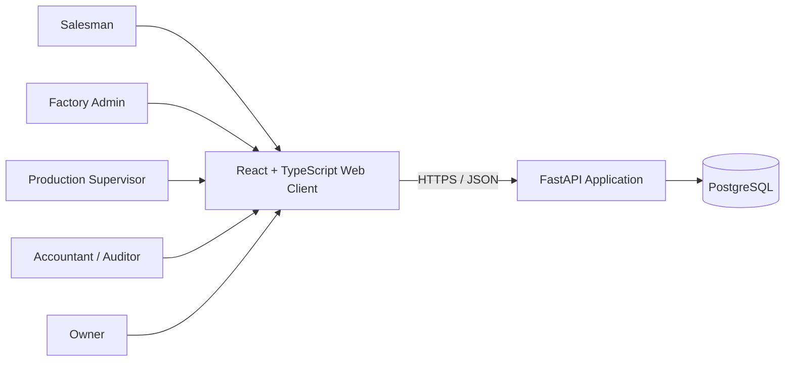
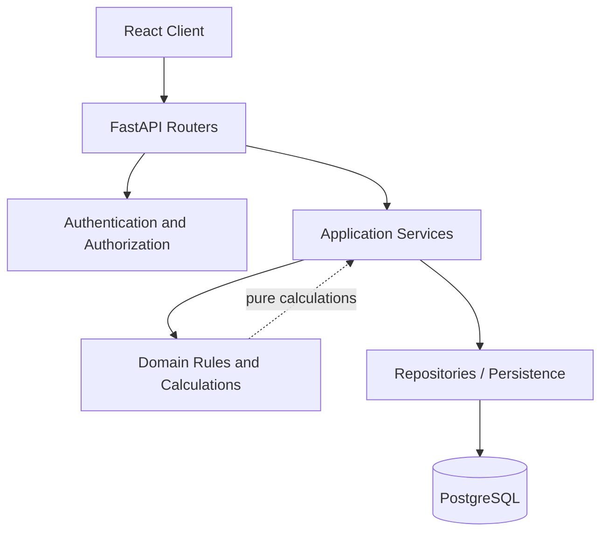

# BatchFlow — System Architecture

**Document:** `docs/architecture.md`  
**Product:** BatchFlow  
**Status:** Architecture baseline; backend implementation in progress  
**Version:** 1.0  
**Last updated:** 2026-11-17  
**Related document:** [Requirements.md](../Requirements.md)

> This document describes the intended full system and its design constraints. The FastAPI/PostgreSQL backend now includes IAM, master data and an initial inventory ledger: stock-adjustment and supplier purchase-receipt posting, append-only source-linked stock movements, on-hand and WAC projections, audit events, idempotency and quantity/value reconciliation. Production, sales, billing, dispatch, payments, frontend and production deployment remain pending; stock movement reversal is now implemented. See the repository README for the verified implementation boundary.

---

## 1. Architectural goals

BatchFlow is a small-manufacturer operations and audit-support application. Its architecture must support the complete business flow:

- Sales: order submission → review and approval → invoice → dispatch → receivable → payment.
- Production: purchase receipt → raw-material availability → BOM-based production → finished-goods receipt → variance and costing.
- Reporting: traceable sales, stock, production, GST, collection and outstanding information.

The architecture prioritizes:

1. **Transactional correctness** for inventory, production, dispatch, invoices and payments.
2. **Traceability** from every posted stock movement and financial event to its source document.
3. **Backend-enforced authorization** for every protected operation.
4. **Exact arithmetic** for quantities and monetary values.
5. **A small, explainable implementation** suitable for an individual developer and a reproducible assessment demo.
6. **Testability** of the benchmark and important failure/concurrency cases.

The system will begin as a modular monolith. There is no current requirement for microservices, a message broker, Redis, a separate analytics database or distributed transactions.

## 2. Architecture decision summary

| Concern | Proposed decision | Rationale |
|---|---|---|
| Application shape | Modular monolith | One deployable backend with explicit business-module boundaries |
| Backend | Python + FastAPI | Typed HTTP API and testable application services |
| Frontend | React + TypeScript | Role-specific responsive web interface |
| Database | PostgreSQL | Relational constraints, row locking and ACID transactions |
| ORM / persistence | SQLAlchemy 2.x | Explicit transaction and query control |
| Schema migrations | Alembic | Versioned, reviewable schema changes |
| Request validation | Pydantic | Validate API input and output contracts |
| Automated tests | Pytest | Unit, integration and end-to-end benchmark tests |
| Local environment | Docker Compose + PostgreSQL 16 | Reproducible local setup; database service implemented |
| Inventory authority | Append-only stock-movement ledger | Auditable source of truth |
| Financial arithmetic | Python `Decimal` and PostgreSQL `NUMERIC` | Avoid binary floating-point errors |
| Authorization | Backend RBAC | Frontend visibility is not a security boundary |

These are project implementation choices. They are not all mandated by the internship source specification.

## 3. High-level system context



The browser client is responsible for presentation and user interaction. The backend owns business rules, authorization, validation, transaction orchestration and persistence. PostgreSQL stores authoritative business records.

The frontend must never be trusted to enforce permissions, calculate authoritative stock, or decide whether a transaction may be posted.

### 3.1 System boundary

**Inside the MVP boundary**

- Authentication and role-based authorization.
- Product, customer, supplier, material and BOM masters.
- Sales order lifecycle and stock availability.
- Invoice generation for the assessment scenario.
- Dispatch.
- Purchase receipt and inventory.
- Production posting, consumption and yield variance.
- Payment recording and outstanding balance.
- Basic production costing and reports.
- Audit trail and CSV/Excel exports.

**Outside the MVP boundary**

- GST portal filing or government API integration.
- Full statutory accounting or general ledger.
- Banking/payment-gateway integration.
- Offline order synchronization.
- GPS/route tracking.
- Batch/expiry/FEFO management.
- Multi-factory operations.
- Multi-tenant SaaS billing.
- Distributed services and event streaming.

## 4. Runtime architecture

The backend follows a layered structure within one deployable application.



### 4.1 Presentation layer

Responsibilities:

- Render role-specific screens and forms.
- Collect user input and display validation results.
- Call the backend API.
- Display server-calculated statuses, totals, stock availability and variances.
- Avoid duplicating business rules as authoritative client-side logic.

The client may perform convenience validation, but the backend must repeat all security- and correctness-relevant validation.

### 4.2 API layer

FastAPI routers are thin HTTP adapters. They:

- Parse and validate request data.
- Resolve the authenticated principal.
- Invoke an application service.
- Translate expected application errors into stable HTTP responses.
- Serialize response DTOs.

Routers must not contain multi-step stock or financial posting logic and must not directly coordinate several database writes.

### 4.3 Application-service layer

Application services implement use cases and coordinate transactions. Examples:

- `SubmitSalesOrder`
- `ReviewSalesOrder`
- `ApproveSalesOrder`
- `PostPurchaseReceipt`
- `PostProductionRun`
- `IssueInvoice`
- `PostDispatch`
- `RecordPayment`

A service establishes the transaction boundary, loads the required records, invokes domain rules, persists the complete result and commits or rolls back.

### 4.4 Domain layer

The domain layer contains business concepts and deterministic rules, including:

- Order state transitions.
- Unit conversion and quantity validation.
- BOM scaling.
- Planned-versus-actual consumption variance.
- Yield variance.
- GST split selection for the benchmark.
- Weighted-average material valuation.
- Production cost calculation.
- Stock availability rules.

Pure calculations should be kept independent of HTTP and database concerns wherever practical. Domain rules must be covered by unit tests.

### 4.5 Persistence layer

The persistence layer uses SQLAlchemy and PostgreSQL. It is responsible for:

- Loading and storing domain records.
- Enforcing database constraints.
- Applying row locks for stock-sensitive operations.
- Writing stock ledger entries and balance projections in the same transaction.
- Supporting explicit query paths for reports.

Repositories should not hide transaction boundaries. The application service owns commit/rollback.

Unit input validation is configuration-driven: KG and L accept up to three decimal places; G, PCS, PACKET and CARTON accept whole-number input. Excess precision is rejected before conversion. Accepted values are normalized to the inventory base unit and persisted at six decimal places. Order review preserves immutable submitted quantity/price snapshots and records every review edit through append-only before/after audit events; a separate revision table is not part of the MVP.

## 5. Business module boundaries

The backend is one application, organized by business capability. Modules may call one another through application-service interfaces or shared domain services; they must not create circular dependencies.

| Module | Owns | Does not own |
|---|---|---|
| Identity & Access | Users, password hashes, roles, authorization checks | Business stock or invoice rules |
| Master Data | Products, customers, suppliers, materials, units, BOM definitions | Posted stock movements |
| Sales | Sales orders, order lines, review and approval lifecycle | Physical stock deduction |
| Inventory | Stock movements, balance projections, reservations, stock availability | Production or sales workflow policy |
| Procurement | Purchase records and raw-material receipt posting | Production consumption |
| Production | Production runs, BOM snapshots, actual consumption, output, variance, run cost and linked correction/reversal workflow | Sales dispatch |
| Billing | Invoice numbering, immutable invoice snapshots, tax calculations, full credit-note cancellation and invoice documents | Physical dispatch |
| Dispatch | Dispatch records and finished-goods issue | Invoice tax calculation |
| Receivables | Customer payments, allocations and outstanding calculations | Banking integration |
| Audit & Reporting | Audit events, read models, exports and report queries | Mutation of source transactions |

### 5.1 Dependency direction

- Sales may request stock availability from Inventory; Inventory does not depend on Sales.
- Procurement calls Inventory to post a receipt.
- Production calls Inventory to post material issues and finished-goods receipts.
- Dispatch calls Inventory to post finished-goods issues.
- Billing uses order and customer/product snapshots but does not mutate inventory.
- Receivables references invoices and payment records.
- Reporting reads records from the business modules; it does not become an alternate source of truth.
- Audit recording is invoked by application services for important business actions.

A module must not write directly into another module's tables merely because the tables are accessible through the ORM. Cross-module changes should go through the owning service or a clearly defined shared transaction operation.

## 6. Core business flows and transaction boundaries

All multi-record posting operations must be atomic: either every required record is committed, or none is.

### 6.1 Sales order, approval and reservation

1. An authenticated salesman submits an order for an assigned customer.
2. The backend validates customer assignment, product status, quantities and price source.
3. The order and line-item snapshots are saved in a submitted state.
4. An admin reviews and may adjust quantities/prices before approval.
5. Approval checks available-to-promise stock under a concurrency-safe transaction.
6. If reservation is enabled for the order, the service creates reservation records in that same transaction.
7. The order state and audit event are committed together.

**Important distinction:** approval/reservation does not reduce physical on-hand stock. A reservation reduces available-to-promise stock only. Physical stock is reduced by a posted dispatch movement.

The initial implementation should use explicit order states and reject invalid transitions. The exact cancellation/release workflow must be defined before cancellation is implemented.

### 6.2 Purchase receipt

One database transaction must:

1. Validate the purchase/receipt and item units.
2. Create the posted receipt record.
3. Append positive stock-movement entries.
4. Update the corresponding stock-balance projection.
5. Record the audit event.
6. Commit.

A failed receipt must not leave stock increased without a source receipt, or a receipt posted without its stock movement.

### 6.3 Production run posting

One database transaction must:

1. Lock or otherwise safely validate the relevant material and packaging balances.
2. Verify sufficient available quantities.
3. Persist the production-run record and the BOM snapshot used.
4. Record actual raw-material and packaging consumption.
5. Append negative stock movements for actual consumption, including damaged pouches.
6. Append a positive finished-goods movement for actual good output.
7. Update all affected balance projections.
8. Persist planned-versus-actual variance and costing inputs/results.
9. Record the audit event.
10. Commit.

If any step fails, the entire posting rolls back. A production run must not deduct materials without recording its output, or record output without deducting its actual inputs.

### 6.4 Invoice issuance

Invoice issuance must:

1. Confirm the order is eligible for invoicing.
2. Determine the applicable tax treatment using the configured supplier/customer state data and the benchmark rule.
3. Calculate taxable value, tax components and invoice total using exact decimal arithmetic.
4. Allocate a unique invoice number within the configured financial-year series.
5. Persist an immutable invoice snapshot and invoice lines.
6. Record the audit event.
7. Commit.

The invoice must preserve the relevant customer, product, HSN, quantity, price and tax details as they existed at issuance. Later master-data edits must not rewrite an issued invoice.

Invoice issuance does not itself deduct physical stock. Dispatch is a separate operation.

### 6.5 Dispatch posting

One database transaction must:

1. Confirm the invoice/order is eligible for dispatch.
2. Lock the finished-goods balance or use an equivalent concurrency-safe stock update.
3. Validate dispatch quantity against authorized undelivered quantity and available stock.
4. Create the dispatch record.
5. Append the finished-goods issue movement linked to the dispatch.
6. Update the finished-goods balance projection.
7. Update fulfilment state and reservation consumption/release as applicable.
8. Record the audit event.
9. Commit.

A repeated request must not create a second dispatch or stock deduction. The MVP may implement full dispatch first; partial dispatch must not be silently assumed if it is not supported.

### 6.6 Payment recording

One database transaction must:

1. Validate the customer, invoice reference, amount and payment date.
2. Create the payment record and allocation to the invoice.
3. Recalculate or update the receivable projection, if one is stored.
4. Record the audit event.
5. Commit.

The service must reject duplicate submissions using an idempotency mechanism or a unique external/reference key where available. Payment allocation rules for overpayments and unallocated receipts must be explicitly decided before those cases are supported.

## 7. Inventory consistency model

### 7.1 Authoritative ledger

The stock-movement ledger is the authoritative history of physical stock changes. Each posted movement must include, at minimum:

- Item identifier.
- Quantity in the item's inventory base unit.
- Movement direction/type.
- Source document type and source document identifier.
- Posting timestamp.
- Acting user.
- Any required unit/rate snapshot for valuation.

Posted movements are append-only. Corrections should use a compensating/reversal movement linked to the original movement rather than silently editing or deleting history.

### 7.2 Balance projection

For efficient availability checks and screens, the application may maintain a current stock-balance projection. It is a derived value, not an independent authority.

The ledger and balance projection must be updated in the same PostgreSQL transaction. A reconciliation query/test must be able to compare the projection with the sum of posted movements for each item and location.

### 7.3 Physical stock and available stock

Keep these concepts distinct:

- **On-hand:** physical quantity represented by posted stock movements.
- **Reserved:** quantity committed to approved orders but not yet dispatched.
- **Available-to-promise:** on-hand less active reservations, subject to the project's chosen policy for any safety buffer.

Approval may create a reservation, but it must not create a physical issue. Dispatch creates the physical issue. Reservation creation, consumption and release must be concurrency-safe.

### 7.4 Concurrency control

Stock-sensitive operations must prevent overselling and negative balances. The initial implementation should use PostgreSQL transactions with row-level locking on the relevant item-balance records, or a carefully tested conditional update strategy.

The transaction must re-check availability after acquiring the lock. A check performed only before the transaction is not sufficient.

For a transaction touching multiple items, lock rows in a deterministic order (for example, ascending item ID) to reduce deadlock risk. Handle serialization/deadlock retry policy deliberately; do not blindly retry non-idempotent operations.

### 7.5 Unit handling

- Store stock quantities in a canonical base unit per item.
- Use explicit conversion definitions for compatible units.
- Do not infer mass-to-volume conversions.
- Preserve entered quantity/unit and conversion context where needed for audit explanation.
- Use fixed-precision numeric types appropriate to the item's measurement precision.

The benchmark requires kg, g, litres, pieces, packets and cartons. Carton-to-packet conversion is product-specific/configured (20 packets per carton in the benchmark).

## 8. Financial and costing rules

### 8.1 Money

- Python calculations use `Decimal`, never `float`, for money.
- PostgreSQL stores money-like values using `NUMERIC(p, s)`, not floating-point columns.
- Currency is INR for the benchmark.
- Rounding rules and calculation boundaries must be explicit and tested.
- API JSON should serialize monetary values as decimal strings or a documented exact representation.

### 8.2 GST

The MVP implements the assessment's 5% benchmark calculation and state-based intra-state/inter-state split. It is not a statutory GST engine and does not file returns or call government services.

Tax calculations should be isolated in a tested domain service. Tax rates and relevant invoice details must be snapshotted on the issued invoice.

### 8.3 Material valuation and production cost

The project selects weighted-average cost (WAC) for the benchmark flour valuation. The inventory/costing design must retain sufficient receipt and issue valuation information to explain the result.

Production run cost includes the benchmark material/packaging consumption plus allocated labour and gas/power. Cost per good packet is calculated from total run cost divided by actual good output. The system must define behavior for zero good output before implementing that edge case.

The benchmark calculation and assumptions remain governed by [Requirements.md](../Requirements.md).

## 9. Authentication, authorization and audit

### 9.1 Authentication

The initial IAM implementation is present in `backend/app`: Argon2 password hashing, user and role persistence, 15-minute HS256 bearer JWTs with `kid`-based verification-key overlap, 256-bit opaque refresh tokens stored only as SHA-256 hashes, 30-day absolute session families, refresh rotation under row locks, reuse-triggered family revocation, Origin validation, credentialed CORS and a user-provisioning CLI. Master-data models and role-protected endpoints cover inventory items, products, customers and salesman assignments, suppliers, compatible unit conversions and inventory locations. The initial inventory module supports draft stock adjustments, controlled opening balances, supplier-linked purchase receipts, append-only stock movements with exactly one source-line reference, atomic on-hand and moving-WAC projection updates, row locking, posting idempotency, audit events and ledger-to-projection reconciliation. PostgreSQL integration tests cover the benchmark flour WAC calculation, purchase receipt posting, idempotency, supplier validation and projection-drift detection. Movement reversals, production issue/output and downstream business modules remain pending. The complete business authorization matrix and administrative user-management interface also remain pending.


- Protected API operations require an authenticated user.
- Passwords are stored as secure password hashes; plaintext passwords are never stored.
- Authentication secrets and signing keys are supplied through environment configuration, not committed to the repository.
- Protected API requests use the Authorization: Bearer header with a signed JWT access token. See [ADR-008](./adr/ADR-008-bearer-token-authentication.md) for the complete decision and operational rules.
- Access JWT lifetime is 15 minutes. Validate signature, fixed algorithm allowlist, issuer, audience, subject, session id, issued-at and expiry.
- Login issues a cryptographically random 256-bit opaque refresh token with a 30-day absolute session-family expiry. Store only its SHA-256 hash in auth_refresh_tokens.
- Refresh tokens rotate on every use. Reuse of a consumed token revokes the entire session family and requires fresh login.
- Refresh tokens are sent only in a Secure, HttpOnly, SameSite cookie scoped to the auth refresh endpoint. Access tokens remain in frontend memory; never store tokens in localStorage/sessionStorage or put them in URLs.
- Logout revokes the session family and clears the refresh cookie. An already-issued access JWT remains valid until its 15-minute expiry; this bounded delay is explicit and acceptable for the MVP.
- Signing keys and issuer/audience configuration are supplied through environment configuration or a secret manager, never committed to source control. Key rotation must support a bounded overlap for active access tokens.

### 9.2 Authorization

The backend must authorize each operation based on the authenticated user's role and relevant record ownership/assignment.

Examples:

- A salesman may submit orders for assigned customers and view only permitted own-order information.
- An admin may review orders, issue invoices, dispatch and record payments.
- A production supervisor may record permitted receipts and production runs.
- An auditor has read-only access to authorized reports.
- An owner has summary/read access as configured.

Role checks must be applied at the API/application-service boundary. Record-level checks (such as salesman-to-customer assignment) are required in addition to broad role checks.

### 9.3 Audit trail

Important actions should produce append-only audit events, including:

- Authentication/security-relevant events where appropriate.
- Master-data changes affecting future transactions.
- Order submission, review, approval and rejection.
- Purchase receipt posting.
- Production posting.
- Invoice issuance.
- Dispatch posting.
- Payment recording and allocation.
- Reversal/correction actions.

An audit event should identify actor, action, target entity, timestamp and relevant before/after or structured change metadata, while avoiding unnecessary secrets or sensitive data.

The audit trail complements source documents and stock movements; it does not replace them.

## 10. API conventions

The API is versioned under `/api/v1`. The initial API is a synchronous JSON HTTP API.

Proposed resource groups:

| Prefix | Resource area |
|---|---|
| `/api/v1/auth` | Login, logout and current user |
| `/api/v1/users` | User administration (restricted) |
| `/api/v1/products` | Products |
| `/api/v1/customers` | Customers and assignments |
| `/api/v1/materials` | Raw and packaging materials |
| `/api/v1/suppliers` | Suppliers |
| `/api/v1/boms` | BOM definitions and versions |
| `/api/v1/orders` | Sales orders and review |
| `/api/v1/purchases` | Purchase and receipt records |
| `/api/v1/production-runs` | Production run recording and posting |
| `/api/v1/invoices` | Invoice issuance and retrieval |
| `/api/v1/dispatches` | Dispatch posting |
| `/api/v1/payments` | Payment recording and allocation |
| `/api/v1/inventory` | Balances, reservations and ledger queries |
| `/api/v1/reports` | Read-only report and export endpoints |

These are proposed resource boundaries, not a finalized endpoint-by-endpoint contract. Detailed methods, schemas, pagination and error codes belong in `docs/api-contract.md`.

### 10.1 API behavior

- Use appropriate HTTP status codes.
- Validate all input on the server.
- Use stable error response shapes.
- Do not expose stack traces, SQL details, password hashes or secrets.
- Paginate potentially large list/report responses.
- Require an idempotency key for high-risk post operations where appropriate (for example dispatch and payment); enforce uniqueness in the database within a defined scope.
- Keep business posting operations explicit; avoid side effects hidden inside ordinary GET or update requests.

## 11. Error handling and idempotency

Expected business errors should be represented explicitly, such as:

- Insufficient stock.
- Invalid order state transition.
- Unauthorized role or record access.
- Duplicate invoice sequence.
- Invalid unit conversion.
- Duplicate posting/idempotency key.
- Invoice/order quantity mismatch.

Unexpected errors should cause the active transaction to roll back and be logged server-side with a correlation/request identifier. Client responses must not leak internal exception details.

For idempotent posting, store the idempotency key and the outcome associated with the operation in the same transaction as the business effect. Reusing a key with a different request payload must be rejected. A retry with the same key and same payload must return the original outcome rather than post again.

## 12. Reporting and read models

The initial reporting implementation should query PostgreSQL through read-only service functions and appropriate indexes. A separate analytics database is unnecessary for the expected MVP scale.

Reports include the scoped outputs from the requirements:

- Stock summary and stock ledger.
- Production run, consumption and variance.
- Sales by period/customer/product.
- GST summary for the exercise.
- Collections and customer outstanding.
- Purchase information where implemented.

Report totals must reconcile to source transactions. Exported CSV/Excel data must use the same filters and calculation rules as the corresponding on-screen report.

## 13. Proposed repository layout

The exact layout may be refined during implementation, but the intended separation is:

```text
BatchFlow/
├── README.md
├── Requirements.md
├── docs/
│   ├── architecture.md
│   ├── database-schema.md
│   ├── transaction-design.md
│   └── api-contract.md
├── backend/
│   ├── pyproject.toml
│   ├── alembic.ini
│   ├── alembic/
│   │   └── versions/
│   ├── app/
│   │   ├── main.py
│   │   ├── core/                 # Configuration, security, shared errors
│   │   ├── api/                  # Router registration and dependencies
│   │   ├── modules/
│   │   │   ├── identity/
│   │   │   ├── master_data/
│   │   │   ├── sales/
│   │   │   ├── inventory/
│   │   │   ├── procurement/
│   │   │   ├── production/
│   │   │   ├── billing/
│   │   │   ├── dispatch/
│   │   │   ├── receivables/
│   │   │   └── audit/
│   │   └── reports/
│   └── tests/
├── frontend/
│   ├── package.json
│   └── src/
├── database/
│   └── seeds/
├── tests/
│   └── scenarios/
└── docker-compose.yml
```

This is a proposed target structure. Directories and files should be created only as their implementation is started; the diagram is not a claim about current repository contents.

## 14. Testing strategy and quality gates

Testing follows the business risk, not just the module list.

### 14.1 Unit tests

Cover deterministic domain rules:

- Unit conversion and invalid dimensional conversions.
- BOM scaling.
- Consumption and yield variance.
- GST calculation and tax split.
- WAC valuation. See [ADR-009](./adr/ADR-009-wac-rounding-policy.md) for numeric scales, ROUND_HALF_UP boundaries and reconciliation rules.
- Production costing.
- Order state transitions.
- Authorization policy helpers.

### 14.2 Database integration tests

Use PostgreSQL-compatible integration tests for:

- Ledger posting and balance projection reconciliation.
- Atomic production posting and rollback.
- Purchase receipt posting.
- Invoice number uniqueness.
- Dispatch idempotency.
- Payment idempotency and allocation.
- Foreign-key and check-constraint behavior.
- Concurrent stock-sensitive operations.

SQLite-only tests are not sufficient evidence for PostgreSQL locking and concurrency behavior.

### 14.3 End-to-end benchmark tests

The complete seed scenario must verify the acceptance values in [Requirements.md](../Requirements.md), including:

- Raw-material and packaging closing balances.
- 188 good packets and 238 finished packets after production.
- −6% yield variance and +5% oil consumption variance.
- Retailer A's ₹7,875 invoice.
- 88 finished packets after dispatch.
- Distributor B's 32-packet shortage.
- ₹3,875 outstanding after the ₹4,000 payment.
- ₹5,855 production run cost and approximately ₹31.14 per good packet.

### 14.4 Release gates

A release is not ready merely because the application starts. It must pass the applicable gate:

1. Schema migrations and seed data work.
2. Authentication and backend authorization tests pass.
3. Inventory ledger and balance projection reconcile.
4. Production posting is atomic and benchmark variances match.
5. Order, invoice and dispatch flows pass stock and idempotency tests.
6. Payment, outstanding and costing calculations match the benchmark.
7. Reports reconcile with source records and exports.
8. Setup instructions allow a reviewer to reproduce the demonstration.

## 15. Deployment and operations

The initial target is a single local/demo environment using Docker Compose:

- One FastAPI application process/container.
- One PostgreSQL database.
- One React frontend development/build service as appropriate.
- Persistent database volume for local demonstration.
- Environment-based configuration for credentials and secrets.

Production-grade high availability, horizontal scaling, managed queues, observability stacks and automated cloud deployment are outside the initial MVP unless a concrete requirement emerges.

Minimum operational safeguards:

- Never commit real credentials or private environment files.
- Provide an example environment file containing placeholders only.
- Apply Alembic migrations explicitly during setup/deployment.
- Back up demo data where needed for reproducibility.
- Log request identifiers and transaction failures without logging secrets.
- Use dummy data only.

## 16. Open decisions before implementation

The following operational policy remains unresolved and must be decided before implementation:

1. **Audit retention:** required retention period and access policy for the assessment prototype.

The previously open decisions for invoice cancellation through a full credit note, unit-specific input precision, production-run correction and order review history are now resolved in docs/database-schema.md §18 and docs/transaction-design.md. Order cancellation/reservation release, full-dispatch-only behavior, payment allocation policy, one-factory location, WAC rounding and bearer-token authentication are also resolved. These policies must not be silently changed in endpoint code.

## 17. Traceability to requirements

This architecture supports the requirements baseline as follows:

| Requirements area | Architectural support |
|---|---|
| FR-001 Authentication | Identity module and backend authorization |
| FR-002–003 Masters and units | Master Data module and canonical unit policy |
| FR-004–006 Order and approval lifecycle | Sales module, Inventory availability and reservation model |
| FR-007 Invoice | Billing module and immutable invoice snapshot |
| FR-008 Dispatch | Dispatch module and atomic Inventory issue |
| FR-009 Purchase receipt | Procurement module and Inventory receipt |
| FR-010–012 BOM and production variance | Production domain and transactional posting |
| FR-013 Inventory ledger | Authoritative append-only ledger and reconciled projection |
| Payment/outstanding requirements | Receivables module |
| Reporting requirements | Read-only reporting services and exports |
| AT-016–019 security/atomicity/idempotency/concurrency | Backend RBAC and PostgreSQL integration tests |

The detailed acceptance criteria and benchmark values remain defined by [Requirements.md](../Requirements.md). If this architecture document and the requirements baseline appear to conflict, the conflict must be resolved explicitly and documented rather than silently changing the benchmark.

---

**BatchFlow — From Order to Audit.**
